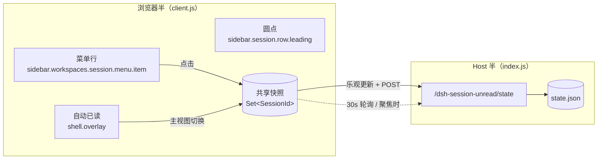

# 会话未读标记 · dsh-plugin-session-unread

给 [DeepSeek Harness](https://github.com/deepseek-harness)（DSH）的会话列表加一个轻量的
**标记未读**：在会话的「…」菜单里一点，侧边栏标题前就亮起一个小圆点；下次点开这个会话，
圆点自己消失。适合「这个会话回头再看」的场景，而不是靠记忆翻历史。


---

## 它做什么

| 入口 | 行为 |
|---|---|
| 会话行「…」菜单 | 多出一行 **标记为未读**；已标记时变成 **标记为已读** |
| 会话行标题左侧 | 已标记的会话显示一个 6px 品牌色圆点，带 `未读` 无障碍标签 |
| 打开会话 | 主视图切进该会话时自动清掉标记（和聊天软件「看了就算已读」一致） |
| 手动清除 | 菜单里的 **标记为已读** |
| 刷新 / 重启 | 标记保存在 Host 侧 JSON 文件里，不会丢 |

标记只是**本地视图偏好**，不会写进会话记录、不会同步给模型，也不会改变会话排序或置顶。

```
┌─────────────────────────────┐
│  ● 排查构建超时的会话    14:02 │   ← 已标记未读
│    整理周报的会话        13:40 │
│    给 README 补截图      昨天  │
└─────────────────────────────┘
```

## 安装

插件是**纯 JavaScript**，没有构建步骤，也不需要 `npm install` 任何运行时依赖。

### 方式一：作为 profile bundle（推荐）

```bash
# 1. 把插件链接进 profile
pnpm --dir "$DSH_PROFILE_DIR" add link:/绝对路径/dsh-plugin-session-unread

# 2. 在 profile 的 package.json 里登记 bundle
#    "dsh": { "profile": { "bundles": [ ..., "dsh-plugin-session-unread" ] } }
```

插件自带的 `cordis.patch.yml` 会把自己的插件条目插进 Cordis 树，所以**不需要**再手写
patch 条目。重启 DSH 桌面端（或刷新 Web 页面）即可生效。

### 方式二：作为 profile patch 条目

在 `$DSH_PROFILE_DIR/cordis.patch.yml` 末尾追加：

```yaml
- insert:
    - id: session-unread
      name: 'dsh-plugin-session-unread'
```

两种方式二选一，**不要同时使用**——同一个 `id` 会被注册两次。

> `$DSH_PROFILE_DIR` 默认是 `~/.dsh/profiles/<profile>`；桌面端默认 profile 为 `desktop`。

### 卸载

删掉 `package.json` 里的 bundle 条目（或 `cordis.patch.yml` 里那一段）与 `link:` 依赖，
重启即可。已写入的状态文件可以一并删除：

```bash
rm -rf "$DSH_HOME/session-unread"
```

## 已读 / 未读的规则

- **标记为未读** 只在当时生效，之后不会阻止任何行为；它就是一个书签式提醒。
- **打开即已读**：主视图切到该会话时清除标记。给「当前正开着的会话」打标记时，圆点会一直
  留到你切走再切回来；应用重启后如果直接停在这个会话上，也会按「你正在看它」处理。
- **和内置状态圆点共用同一格**：DSH 本身会在标题左侧显示运行中 / 等待审批 / 未读完成等
  状态。这些状态优先级更高，出现时占用格子；等它们结束后，你的未读圆点会重新出现。
  这是该位置的设计约定，避免两个圆点并排。
- 标记对**归档会话**不可见（归档行左侧为空白），但标记本身会保留，取消归档后照常显示。

## 数据与接口

状态文件（Host 侧，原子写入，路径可由 `DSH_HOME` 覆盖）：

```
$DSH_HOME/session-unread/state.json
```

```json
{
  "version": 1,
  "updatedAt": "2026-11-06T06:12:41.000Z",
  "sessionIds": ["session-7ddae8f7-e4a3-4135-ac57-ab765f3def57"]
}
```

浏览器半通过同一个 Web Server 上的路由读写它：

| 方法 | 路径 | 请求体 | 响应 |
|---|---|---|---|
| `GET` | `/dsh-session-unread/state` | — | `{ "ok": true, "sessionIds": [...], "updatedAt": "..." }` |
| `POST` | `/dsh-session-unread/state` | `{ "sessionId": "…", "unread": true }` | 写入后的完整状态 |

校验：`sessionId` 必须是 harness 生成的 slug，`unread` 必须是布尔值；非法请求返回 `400`，
非 `GET/HEAD/POST` 返回 `405`。文件损坏时按空集合处理并打一条警告，不会拖垮 GUI。

## 实现



浏览器半只注册三个 slot 条目，不 import 任何其他UI包（唯一依赖是 `react`，由 loader 提供）：

| Slot | `id` / `order` | 作用 |
|---|---|---|
| `sidebar.workspaces.session.menu.item` | `session-unread` / `250` | 「…」菜单行，插在「重命名」和「派生」之间 |
| `sidebar.session.row.leading` | `session-unread` / `100` | 标题前的圆点，行处于空闲态时渲染 |
| `shell.overlay` | `session-unread.auto-read` / `9050` | 不渲染任何像素，只观察主视图切换并清除标记 |

Host 半只做三件事：读一次 JSON、注册一条精确路由、把每次写入原子落盘。所有 Cordis 资源都
包在 `ctx.effect(...)` 里，插件卸载时路由、轮询、样式表一起回收。

```
.
├── index.js                 # Host 半：状态路由（纯 Node，无依赖）
├── client.js                # 浏览器半：三个 slot 注册 + 状态同步
├── lib/unread-store.js      # JSON 状态存储（原子写、串行化、容错）
├── cordis.patch.yml         # bundle 自带的插件条目
├── locale/{zh,en}.json      # 插件市场展示用的元数据
└── test/
    ├── unread-store.test.js # 存储：持久化、并发、损坏文件
    ├── route.test.js        # 路由：GET/POST/400/405、重启后仍在
    └── client.test.js       # 浏览器半：在假宿主里跑注册与组件渲染
```

## 开发

```bash
npm test
```

三组测试都用 Node 内置的 `node:test`，不需要浏览器、不需要构建、不联网。
`test/client.test.js` 会在一个极小的假宿主里求值 `client.js`（假的
`window.__ModuleLoader__`、`document`、React 与 Cordis context），因此注册的 slot、
注入面、菜单文案与点击行为都在测试里被固定下来。

## 兼容性

- 面向 DSH 0.2.x 的 Web / 桌面端插件体系，使用公开的 slot 契约与 `webServer` 路由。
- 已在 DSH `0.2.1` / `0.2.2` 的客户端 bundle 上核对过实际 slot 声明。
- 依赖三个稳定的公开位置：`sidebar.workspaces.session.menu.item`、
  `sidebar.session.row.leading`、`shell.overlay`（均声明于 `ui-workspace` /
  `ui-context-menu`）。

## 已知限制

- 圆点与内置状态圆点共用一格，运行中/等待交互时会临时让位（见上文规则）。
- 状态是「本机偏好」：不同机器、不同 profile 各自独立。
- 不监听「会话被删除」；已删除会话的残留 id 会一直留在 JSON 里（体积极小，不影响渲染）。

## License

[MIT](./LICENSE)
